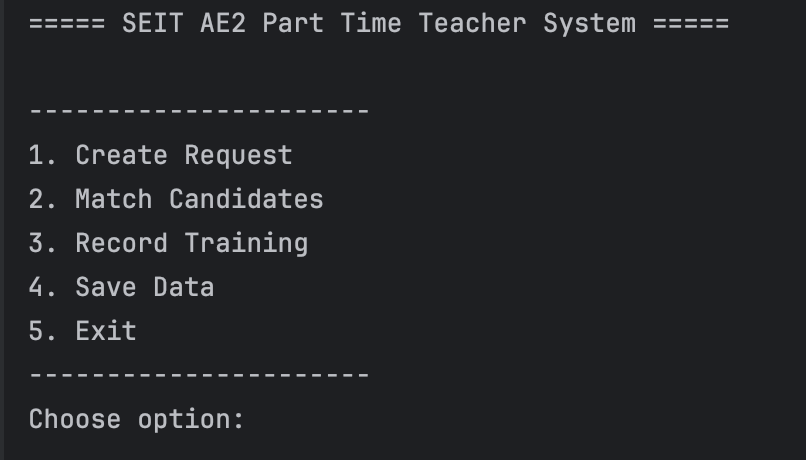
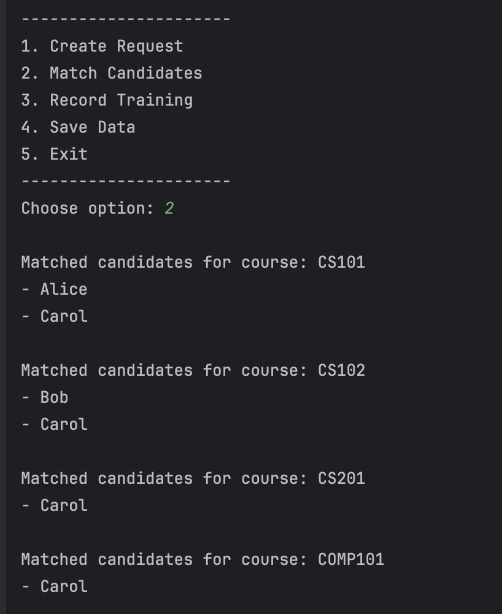
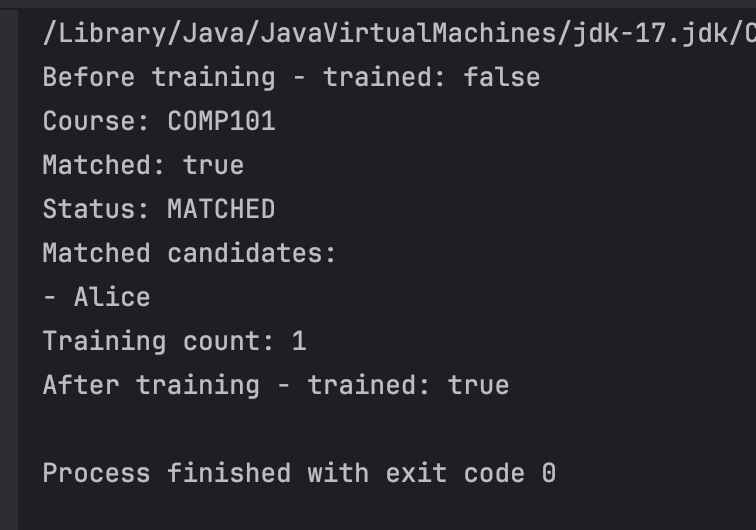

# Part-Time Teaching Request Management System

## Project Overview
This project is a Java backend system for managing part-time teaching requests. It was developed as part of a six-member team project, focusing on system design, object-oriented programming, and collaborative software development.

The system allows users to create teaching requests, match candidates based on skills, record training information, and persist data using a file-based storage mechanism.

---

## My Contributions
- Took a leading role in coordinating system integration and ensuring consistency across components  
- Designed and implemented core entity-layer classes, including:
  - `TeachingRequest`
  - `PTTMember`
  - `TrainingRecord`
- Contributed to testing, debugging, and final system demonstration  
- Ensured alignment between UML design and implementation  

---

## System Design Highlights
- **Layered Architecture**
  - Entity layer: data models (e.g., TeachingRequest, PTTMember)
  - Service layer: business logic (e.g., MatchingEngine, RequestManager)
  - Persistence layer: data storage (SimpleDatabase)

- **Design Patterns**
  - Strategy Pattern: flexible skill-based matching logic  
  - Singleton Pattern: shared access to persistence component  

- **Data Persistence**
  - File-based storage using a custom SimpleDatabase class  
  - Load/save functionality for application state  

- **Engineering Considerations**
  - Separation of concerns for maintainability  
  - Consideration of scalability limitations of file-based persistence  

---

## How to Run
1. Open the project in IntelliJ IDEA  
2. Navigate to `Main.java`  
3. Run the program  
4. Use the command-line interface to:
   - Create requests  
   - Match candidates  
   - Record training  
   - Save/load data  

---

## Technologies Used
- Java  
- Object-Oriented Programming (OOP)  
- UML (Class & Sequence Diagrams)  
- Git (team collaboration)

---

## Screenshots

These screenshots demonstrate the key functionalities of the system, including request creation, candidate matching, and system output.

### System Start

### Matching Process

### System Output

---

## Notes
This repository is a portfolio-focused version of a team project.  
It has been adapted to highlight my contributions and key system design aspects.
